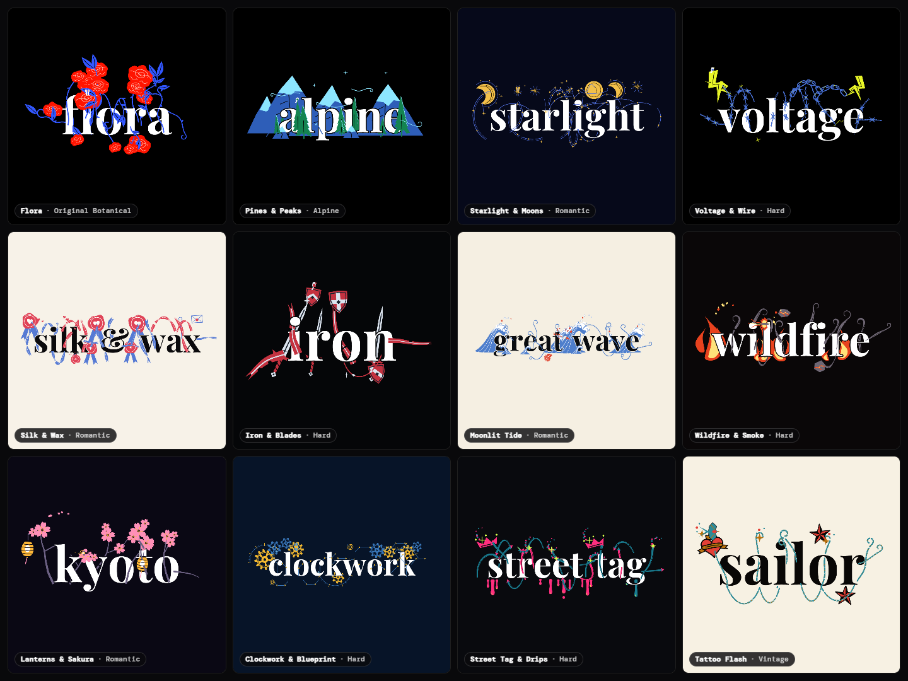
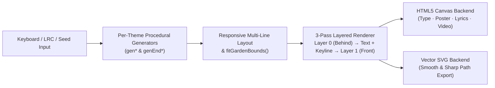

# Type Garden — Multi-Theme Generative Type, Poster & Lyric Video Studio

An interactive, zero-dependency generative typography studio built in a single self-contained HTML/CSS/Canvas/SVG file (`index.html`). Type in real time to grow procedural art around every letterform across **12 distinct visual themes** and **120 curated palettes**, then export crisp **PNG**, vector **SVG**, **1080×1080 animated Poster loops**, or **LRC-synced vertical/square/widescreen Lyric videos** (MP4/WebM/PNG frames).



> **Credits & Attribution**
> The original concept and **only the botanical `Flora` theme** (roses, vines, leaves, and butterflies) are credited to **Akshat Agarwal**'s original [Type Garden](https://type-garden.vercel.app/).
> **Everything else in this repository** — all **11 additional visual themes**, **110 mathematically contrast-audited palettes**, the scalable native Popover theme menu, woodcut text keyline separation, custom procedural engines, interactive visitors, double-click gifts, and multi-theme Poster & Lyrics Studio integration — was designed and built by **[@BerrF35](https://github.com/BerrF35)**.

---

## Visual Themes (12 Themes · 120 Palettes)

Every non-Flora theme ships with **10 mathematically WCAG-audited palettes** (enforcing crisp separation between typography, generative elements, and canvas backgrounds) plus a background-colored woodcut keyline around letterforms so text stays legible over dense motifs.

| Theme | Category | Core Procedural Motifs | Interactive Visitor | Double-Click Canvas Gift | URL Deep Link |
| :--- | :--- | :--- | :--- | :--- | :--- |
| **Flora** *(original concept by Akshat Agarwal)* | Botanical | Roses, weaving thorny stems, leaves | Butterfly | Blooming rose | `?theme=flora` |
| **Pines & Peaks** | Alpine | Faceted craggy mountains, woodblock hatching, layered snowcaps, swaying conifers, mist wisps | Mountain bird | Snowcapped peak + twin pines | `?theme=alpine` |
| **Starlight & Moons** | Romantic | Hollow crescent & lunar medallions, weaving orbits, asymmetric constellations, 8-point sunbursts, charms | Luna moth | Crescent moon + halo + stars | `?theme=starlight` |
| **Voltage & Wire** | Hard | Braided barbed wire, 7-vertex sculpted lightning bolts, interlocking chains, live electric arcs, sparks | Graphic raven | Jagged lightning strike | `?theme=voltage` |
| **Silk & Wax** | Romantic | 3D-twisting flat satin ribbons, scalloped wax seals with embossed hearts, folded love-note envelopes, flourishes | Origami paper plane | Poured wax seal + twin ribbons | `?theme=silk` |
| **Iron & Blades** | Hard | Double-edged broadswords & crossed daggers, tattered heraldic banners, gothic heater shields, forged lances | War falcon | Crossed swords + chevron shield | `?theme=iron` |
| **Moonlit Tide** | Romantic | Hokusai breaking waves, scalloped seafoam crests & talons, carved flow lines, currents, nautilus shells | Kohaku koi fish | Concentric water ripples + wavelet | `?theme=tide` |
| **Wildfire & Smoke** | Hard | Layered S-whip woodblock flames, billowing calligraphic smoke plumes, cracked magma coals, diamond embers | Rising phoenix | Crossed charred logs + hearth blaze | `?theme=ember` |
| **Lanterns & Sakura** | Romantic | Gnarled cherry boughs, 5-petal V-notched sakura blossoms, swaying Chochin paper lanterns, drifting petals | Luminous firefly | Cherry twig + swinging lantern + blossoms | `?theme=sakura` |
| **Clockwork & Blueprint** | Hard | Skeletonized involute-meshed counter-rotating gears, 45° CAD drafting tracks, vernier compasses, hairsprings & hex bolts | Clockwork dragonfly | Meshed 2-gear escapement + vernier arc | `?theme=clockwork` |
| **Street Tag & Drips** | Hard | Tilted 3-point graffiti crowns, wildstyle barbed arrows, glossy viscous paint drips, aerosol splatters | Winged crown | Stencil crown + crossed arrows + drips | `?theme=street` |
| **Tattoo Flash** | Vintage | Sailor Jerry sacred hearts, 10-facet two-tone nautical stars, maritime anchors, twisted sailor ropes, triad dots | Sailor swallow | Maritime anchor + split nautical star | `?theme=flash` |

---

## Studio Modes & Features

### 1. Live Type Mode
- **Type** any character to grow themed procedural art around each letterform.
- **Space** cuts/crests/sparks the trailing accent and seals the finished word with a dedicated word-end motif.
- **Backspace** smoothly withers/fades/ebbs the last letter.
- **Enter** clears the canvas.
- **Click** anywhere to summon the theme's live animated visitor (perches dynamically on hero crowns, peaks, waves, gears, lanterns, or roses).
- **Hide flyers (`Alt+B`)** removes all active birds, butterflies, and flying visitors immediately and disables new spawning across Type, Poster, and Lyrics modes (persisted in `localStorage`, keyboard-accessible with `aria-pressed` & live-region status announcements).
- **Double-click** anywhere to plant a themed canvas gift.
- **Export** directly to high-DPI **PNG**, clean vector **SVG** (matching both smooth quadratic and sharp polygonal geometry), or live canvas **REC** video.

### 2. Poster Studio (`1080×1080`)
- Deterministic seeded compositions with 7 animated loop presets (*Breathe*, *Grow & wither*, *Typed*, *Gust*, *Reach*, *Scatter*, *Visitor*) with theme-tailored copy.
- Export static PNG, vector SVG, looping WebM/MP4 video, or ZIP PNG frame sequence.

### 3. Lyrics Video Studio
- Supports plain text or timestamped `.lrc` lyrics (`[MM:SS.XX]`), optional audio upload (`.mp3` / `.wav`) with muxed audio export, live tap-to-sync line timing, and 4 aspect ratios (`9:16 Reels`, `1:1 Square`, `16:9 Wide`, `4:5 Feed`).
- Configurable typing cadence, cascade/wither/clear transitions, ambient motion, hand-drawn boil jitter, and theme visitor toggle.

---

## Architecture

Everything runs client-side with zero build step and zero runtime dependencies beyond Google Fonts (`Playfair Display` & `DM Mono`, with graceful system fallbacks).



---

## Running Locally & Deploying

### Run Locally
Open `index.html` directly in any modern browser, or serve it with any static HTTP server:

```bash
# Using Node.js (npx)
npx serve .

# Or using Python
python -m http.server 5173
```

Then visit `http://localhost:5173` (or jump directly to any theme via `?theme=clockwork`, `?theme=tide`, `?theme=sakura`, etc.).

### GitHub Pages
This repository is ready for **GitHub Pages** out of the box (includes `.nojekyll` and relative asset paths):
1. Go to **Settings → Pages** in this repository.
2. Under **Build and deployment**, select **Deploy from a branch** → `main` → `/ (root)`.
3. Save — your live studio will be available at `https://berrf35.github.io/typegarden/`.

---

## Credits & License

- **Original Botanical Concept (`Flora`)**: **Akshat Agarwal** — [type-garden.vercel.app](https://type-garden.vercel.app/). Only the original floral theme concept (roses, stems, leaves, butterflies) originates from Akshat Agarwal's Type Garden.
- **All Other Themes & Studio Expansions**: **Jaijitesh Suryaprakash J ([@BerrF35](https://github.com/BerrF35))** — *Pines & Peaks*, *Starlight & Moons*, *Voltage & Wire*, *Silk & Wax*, *Iron & Blades*, *Moonlit Tide*, *Wildfire & Smoke*, *Lanterns & Sakura*, *Clockwork & Blueprint*, *Street Tag & Drips*, *Tattoo Flash*, all 110 custom palettes, Popover theme studio UI, woodcut readability system, and multi-theme Poster/Lyrics engine.
- Released under the [MIT License](LICENSE).
